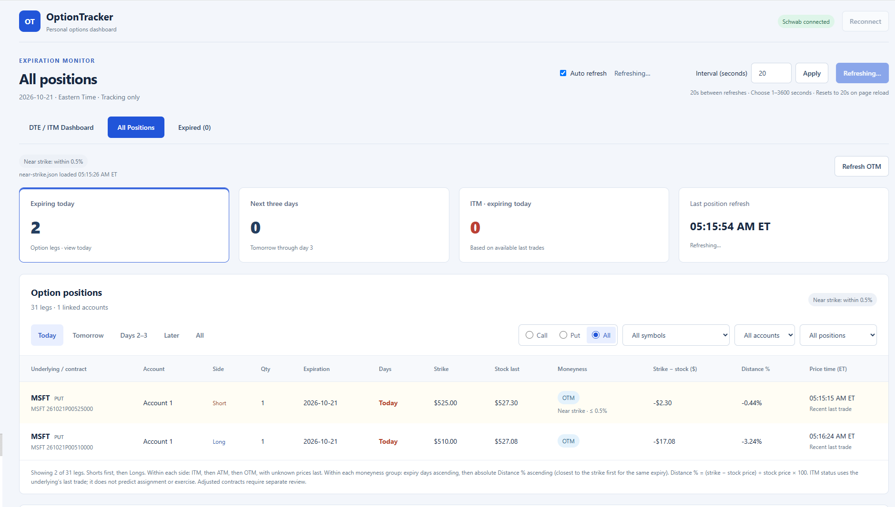
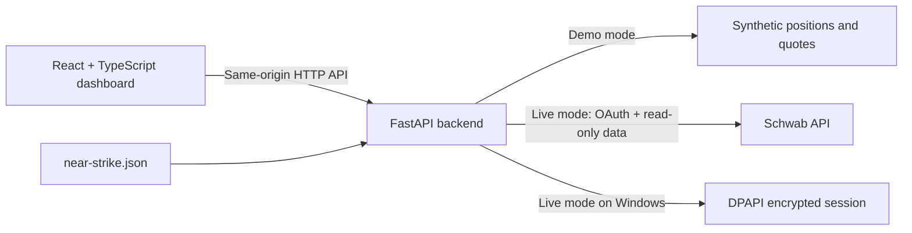

# OptionTracker

**A local options monitoring dashboard built with React, TypeScript, Python, and FastAPI.**

OptionTracker organizes open option contracts by expiration, position direction, and moneyness. Its main purpose is to make an options portfolio easier to review: see which contracts expire soon, identify short in-the-money positions, and inspect how close an underlying price is to a strike without repeatedly sorting brokerage screens.

The application retrieves quotes and positions through the Schwab API. It exposes no order placement, cancellation, or exercise operations. A credential-free demo uses entirely synthetic positions and prices, making the application easy to explore without a brokerage account.

> **Public edition:** This repository includes selected OptionTracker application code, a dashboard screenshot, a synthetic-data demo, tests, and build configuration. Brokerage credentials, raw account exports, runtime state, and private deployment configuration are excluded. It is a curated subset of the privately maintained project.

Live brokerage use requires separate configuration and validation.

## Dashboard preview

The All Positions view brings expiration summaries, contract filters, moneyness, near-strike highlighting, and automatic refresh controls into one screen.



This sample capture shows the connected dashboard with account aliases. Displayed positions, prices, and timestamps reflect the captured screen; the optional demo below uses synthetic data.

[Open the dashboard screenshot at full size](assets/dashboard.png).

## Optional: run the demo

Use **Python 3.11+** and **Node.js 22+**. Demo mode is designed to run without API keys, local certificates, or brokerage authorization. Internet access is needed to install dependencies; the demo data provider makes no brokerage requests.

From the repository root in Windows PowerShell:

```powershell
python -m venv .venv
.\.venv\Scripts\python.exe -m pip install -r backend/requirements.txt
npm --prefix frontend ci
npm --prefix frontend run build
.\Start_Demo.bat
```

The launcher opens [http://127.0.0.1:8181](http://127.0.0.1:8181). Keep its terminal open while using the dashboard; press Ctrl+C to stop the server.

On macOS or Linux:

```bash
python3 -m venv .venv
.venv/bin/python -m pip install -r backend/requirements.txt
npm --prefix frontend ci
npm --prefix frontend run build
cd backend
OPTIONTRACKER_DEMO=1 ../.venv/bin/python run.py
```

The demo is visibly labeled. Its fictional positions use dates relative to today so the expiration views remain useful. It does not read brokerage credentials or saved sessions. Try the DTE dashboard, All Positions filters, Expired view, refresh controls, and a quick quote using a demo symbol shown in the table.

## What the application does

| Capability | Behavior |
| --- | --- |
| Short ITM dashboard | Groups short in-the-money option legs by ascending calendar days to expiration (DTE), including longer-dated positions. |
| All Positions | Shows individual long and short call/put legs, quantities, strikes, expiration, underlying prices, and moneyness. |
| Filters | Combines expiration buckets, account aliases, underlying symbol, call/put, and moneyness or near-strike status. |
| Expired view | Separates prior-date contracts and expiration-day contracts after the configured display convention of 4 p.m. Eastern. |
| Quote lookup | Retrieves last, bid, ask, timestamps, and available delay information for one symbol. |
| Automatic refresh | Refreshes positions and underlying quotes with a configurable 1–3600-second interval; the default is 20 seconds after each completed refresh. |
| Near-strike rules | Supports configurable dollar or percentage thresholds, a default rule, and per-symbol overrides loaded without restarting. |
| Connection recovery | Handles expired authorization, token renewal, temporary upstream errors, and reconnect states. |

Refreshes do not overlap. Quote requests run in batches of up to four, and the UI distinguishes missing prices, stale snapshots, and failed refreshes. Account numbers and balances are omitted from the position response; the dashboard uses labels such as `Account 1`.

## Engineering highlights

- **Full-stack integration:** typed React components consume a small same-origin FastAPI API; FastAPI also serves the production frontend bundle.
- **Testable domain logic:** expiration calculations, moneyness, proximity rules, distance calculations, and sorting are isolated from rendering in `frontend/src/tracking.ts`.
- **Stateful API integration:** OAuth state is browser-bound and single-use; access-token renewal is serialized to avoid concurrent refresh-token rotation.
- **Failure-aware UI:** request timeouts, refresh scheduling, timestamp labels, and explicit recovery states make partial failures visible.
- **Local security boundaries:** a loopback listener, trusted-host checks, same-origin POST checks, restrictive response headers, and backend-only credentials limit exposure.
- **Regression coverage:** tests exercise OAuth, response mapping, financial display calculations, configuration validation, encrypted persistence, and abrupt Windows TLS disconnects.

## Architecture



The frontend receives normalized quote and position records, never OAuth tokens. The backend parses standard option symbols, preserves each long/short leg, and returns unknown metadata when it cannot classify a contract. There is no database, background service, or hosted infrastructure requirement.

```text
backend/
  app.py                    API, OAuth, session renewal, response normalization
  config.py                 Explicit credential loading and portable data paths
  demo.py                   Synthetic data provider
  near_strike.py            Validated, reloadable threshold configuration
  token_store.py            Windows DPAPI persistence and atomic replacement
  run.py / setup_tls.py      Local server launcher and certificate generator
  test_*.py                 API, configuration, demo, and recovery tests
frontend/
  src/main.tsx              Dashboard, filters, refresh orchestration
  src/tracking.ts           Pure date, classification, and sorting functions
  src/style.css             Dashboard styling
  test-tracking.mjs         Domain calculation regression checks
.github/workflows/checks.yml Automated backend tests and frontend build checks
near-strike.json             Generic display thresholds
Start_Demo.bat               Windows synthetic-demo launcher
Start_OptionTracker.bat      Windows live/connection-preview launcher
```

## Live brokerage integration

Live mode is intended for **one user and one backend process on Windows**, where session persistence uses Windows DPAPI. The repository does not contain credentials, certificates, saved sessions, or real portfolio fixtures.

1. Configure your own Schwab developer application and access to the required market-data and account-position APIs. Register the exact callback `https://127.0.0.1:8182/callback`. Availability and entitlements depend on your brokerage/developer account.
2. Set `SCHWAB_CLIENT_ID` and `SCHWAB_CLIENT_SECRET` in the backend process environment, or explicitly set `SCHWAB_CONFIG_FILE` to a credential JSON file outside the repository. The environment-variable pair takes precedence.
3. Supply a trusted local TLS certificate and key for `127.0.0.1` using `OPTIONTRACKER_TLS_CERT` and `OPTIONTRACKER_TLS_KEY`. The optional `backend/setup_tls.py` script generates a localhost leaf certificate in the application data folder; certificate trust is a separate OS configuration step. Never bypass certificate verification.
4. Ensure `OPTIONTRACKER_DEMO` is unset or `0`, then run `Start_OptionTracker.bat` or `python run.py` from `backend` in the configured environment.
5. Open [https://127.0.0.1:8182](https://127.0.0.1:8182), select **Connect Schwab**, and complete authorization on the brokerage website.

Without TLS, the launcher serves an HTTP connection preview on port 8181; live OAuth cannot complete there. `npm run dev` is a frontend development server without an API proxy, so use the built frontend served by FastAPI for the complete application.

An explicitly configured credential file has this shape; these are placeholders, not working credentials:

```json
{
  "option_tracker": {
    "client_id": "YOUR_CLIENT_ID",
    "client_secret": "YOUR_CLIENT_SECRET"
  }
}
```

| Environment variable | Purpose |
| --- | --- |
| `OPTIONTRACKER_DEMO` | Set to `1` for synthetic data, disabled OAuth, and no credential/session loading. |
| `SCHWAB_CLIENT_ID`, `SCHWAB_CLIENT_SECRET` | Backend-only developer credentials for live mode. |
| `SCHWAB_CONFIG_FILE` | Optional explicit path to the JSON credential file. No credential file is discovered automatically. |
| `OPTIONTRACKER_DATA_DIR` | Overrides the directory for encrypted sessions and generated TLS files. Keep it outside the repository. |
| `OPTIONTRACKER_TLS_CERT`, `OPTIONTRACKER_TLS_KEY` | Optional paired paths to your trusted local certificate and private key. |

The default data directory is `%LOCALAPPDATA%\OptionTrackerShowcase` on Windows, or `~/.local/share/optiontracker-showcase` elsewhere. Live encrypted-session persistence requires Windows; the demo does not use it. TLS files generated by the helper live under `tls/` within that data directory.

Tokens stay in the backend and are encrypted at rest for the current Windows user. The browser receives only an opaque secure, HttpOnly, SameSite session cookie. Access logging is disabled to keep callback authorization codes out of request logs. This is a local application, not a multiuser public hosting deployment.

## Display rules

- **DTE** means calendar days, calculated using `America/New_York`, not trading days.
- **Moneyness** compares the underlying's last price with the strike. Unavailable or unusable prices remain `Unknown`.
- **Distance %** is `(strike − underlying price) / underlying price × 100`. Positive values mean the underlying would need to rise to reach the strike; negative values mean it would need to fall.
- **Near-strike percentage** uses a different denominator: `abs(underlying price − strike) / strike × 100`. Dollar mode uses the absolute dollar difference. Threshold boundaries are inclusive.

Edit `near-strike.json`, then select **Refresh OTM** in the app to reload the rules. For example, this fictional symbol overrides the default with a $2 band:

```json
{
  "default": {"$": 3, "%": 0.5, "use": "%"},
  "DEMO": {"$": 2, "%": 0.5, "use": "$"}
}
```

Both numeric thresholds remain in each entry; `use` selects the active one. Invalid edits leave the last valid configuration in place and show an error.

## Validation

From an environment with the backend dependencies installed:

```bash
python -m pytest backend -q
npm --prefix frontend test
npm --prefix frontend run build
```

Backend tests use synthetic payloads and isolated temporary configuration. They cover OAuth state/cookies, quote and position mapping, token refresh and revocation, safe error responses, configuration parsing, demo isolation, and persistence. Windows-only tests exercise real DPAPI encryption and TLS-reset recovery; those checks are skipped on other operating systems. Frontend tests cover Eastern dates, summer/winter expiration cutoffs, near-strike boundaries, missing data, short-ITM grouping, and ordering. The build also runs TypeScript strict type checking.

The included GitHub Actions workflow runs tests and the frontend build on Windows and Linux. Simulated API tests are not proof of live brokerage access or current account entitlements.

## Scope and limitations

OptionTracker supports monitoring and review. It is not a trading system or financial recommendation engine. ITM and near-strike labels do not predict assignment, exercise, or future returns.

The 4 p.m. Eastern expiration cutoff is a display convention, not exchange-specific settlement logic. The Expired view includes only legs present in the current position response; it is not a historical archive. Adjusted option deliverables, spread reconstruction, Greeks, P&L, and transaction history are outside the current scope. Browser throttling can delay refreshes, and source quotes may be delayed or stale.

The public version includes application source, the selected dashboard screenshot, synthetic examples, tests, and build configuration. Local credentials, raw portfolio exports, runtime logs, generated certificates, installed dependencies, and private development history are excluded.
